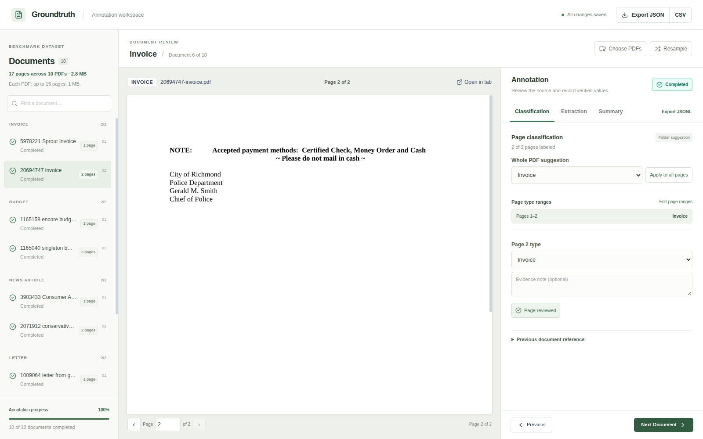

# Step 1 · Ground-truth annotation

The ground truth is the set of correct answers that every model output is compared with. If it
is wrong, every score built on it is wrong too, so it got the most care of any step.

## What one reference answer contains

Each document gets one answer per job. Here is the complete reference for the Sprout invoice,
taken from [`data/final-reference.json`](data/final-reference.json):

```jsonc
{
  "id": "invoice-5978221-sprout-invoice",
  "file": "invoice/5978221-Sprout-Invoice.pdf",
  "category": "invoice",

  // Summarization: what a good summary must say
  "summary": "This invoice was issued by Sprout Social to Alexa Popplewell of the Santa Rosa Police Department for an annual premium plan subscription totaling $1,188.00. The invoice was billed on September 28, 2018, with payment due on receipt. Records confirm full payment of $1,188.00 via Visa on October 1, 2018, leaving a zero remaining balance.",

  // Classification: the correct label for every page
  "classification": [{ "page": 1, "label": "invoice" }],

  // Extraction: the fields asked for, and their correct values
  "extraction": {
    "fields": [
      {
        "name": "Invoice Number",
        "type": "Text",
        "description": "Invoice Number stated in the invoice.",
      } /* …4 more */,
    ],
    "values": {
      "Invoice Number": "1102092",
      "Invoice Date": "Sep 28, 2018",
      "Vendor / Seller Name": "Sprout Social",
      "Total Amount": "$1,188.00",
      "Due Date": "Sep 28, 2018",
    },
  },
}
```

### The fields are fixed per category

Every document of a category is asked the same five questions. That makes documents comparable,
and the list becomes the exact instruction sent to DocWeaver.

| Category     | Fields                                                                                                                                       |
| ------------ | -------------------------------------------------------------------------------------------------------------------------------------------- |
| invoice      | Invoice Number · Invoice Date · Vendor / Seller Name · Total Amount · Due Date                                                               |
| letter       | Letter Date · Sender Name / Organization · Recipient Name / Organization · Subject / Reference · Main Purpose / Request                      |
| email        | Date / Time · From (Sender) · To (Recipient) · Subject · Core Message / Action Item                                                          |
| budget       | Fiscal Year / Period · Organization / Department Name · Total Budget / Revenue · Total Expenditure / Costs · Net Balance / Surplus / Deficit |
| news article | Headline / Title · Author / Byline · Publication Date · Publication Source / Organization · Primary Subject / Topic                          |

The five categories are also the classification labels. Each has a one-line description that is
sent to the model, for example _invoice: "A bill requesting payment for goods or services."_

## How the annotation was done

The answers were written in a small local web app, kept in [`app/`](app/). It shows each PDF
page next to a form, so the annotator reads the source and types what it says.

```bash
cd 01-ground-truth-annotation/app
npm install
npm run load-reference   # optional: open the final reference instead of a blank set
npm run dev              # http://localhost:3000
```

It reads the PDFs from the repo's [`data/`](../data/) folder, the same one the evaluation tool uses. Page counts and page
images come from Poppler (`pdfinfo`, `pdftoppm`). Setup details are in the
[app README](app/README.md).

### 1. Choose the documents

**Choose PDFs** lists every PDF in a category with its size. The app enforces the selection
rules: exactly **2 PDFs per category**, each **1 MB or smaller** and **1–15 pages**.
**Pick 2 at random** draws only from PDFs that pass those limits.


### 2. Label every page

Each page gets its own label. **Apply to all pages** sets one label for the whole PDF; a page
that differs is changed on its own. Below is page 2 of the Richmond invoice: a short payment
note that is still part of the invoice. Four of the six model setups labelled it a letter.



### 3. Fill in the fields

The five fields of the category, one box each. A field that the document does not contain is
left blank.


### 4. Write the summary, then mark the document complete


Every edit saves automatically. **Export JSON** downloads the full set; that file is what the
evaluation reads.

### What the export contains

| Key                  | What it holds                                        |
| -------------------- | ---------------------------------------------------- |
| `categorySchemas`    | the five field names for each category               |
| `selectedCategories` | the categories in the evaluation; also the labels    |
| `selectedDocuments`  | the chosen PDFs                                      |
| `annotations[path]`  | field values, summary, page labels, `completed` flag |

One annotation in the export looks like this:

```jsonc
"invoice/5978221-Sprout-Invoice.pdf": {
  "relativePath": "invoice/5978221-Sprout-Invoice.pdf",
  "category": "invoice",
  "filename": "5978221-Sprout-Invoice.pdf",
  "extraction": { "Invoice Number": "1102092", "Total Amount": "$1,188.00", "…": "…" },
  "summary": "This invoice was issued by Sprout Social to …",
  "completed": true,
  "updatedAt": "2026-10-31T12:02:45Z"
}
```

## From export to final reference

The ground truth changed during the project. That is normal, and both versions are kept:

```text
annotation app export          final reference
(31 Oct, 15 documents)   ──►   (2 Nov, 10 documents)
data/annotation-export.json    data/final-reference.json
                         │
                         ├─ documents re-selected: 2 per category, 6 kept, 4 added
                         ├─ classification made per page (17 page labels)
                         ├─ references corrected where the PDF showed otherwise
                         └─ 4 ambiguous fields excluded from scoring, with reasons
```

**Why per-page labels?** A document-level label hides mistakes. In the final run, every Textract
model labelled every _document_ correctly (100%), but page accuracy ranged from 77% to 94%. All 13
mislabelled pages, across all six setups, were a second or third page; no first page was ever wrong.

**Why exclude fields instead of guessing?** If there is no single correct answer, any score for
it measures luck. The four exclusions, each with its reason, are recorded in the file:

| Document                         | Field                | Reason                                                    |
| -------------------------------- | -------------------- | --------------------------------------------------------- |
| 20694747-invoice                 | Vendor / Seller Name | seller vs remittance recipient is ambiguous               |
| 1004917-mayors-letter            | Subject / Reference  | no single explicit subject                                |
| 1009064-letter-from-gov-…        | Subject / Reference  | the topic has to be inferred; no explicit subject         |
| 3903433-Consumer-Alert-Newspaper | Publication Date     | a handwritten date, not confirmed as the publication date |

## How the code uses the ground truth

[`ground-truth.mjs`](ground-truth.mjs) is the only file that reads the raw format. Everything
downstream works from its output.

```text
annotation-export.json ─► fromAnnotationExport() ─┐
                                                   ├─► normalizeGroundTruth() ─► one internal form
final-reference.json  ─────────────────────────────┘          │
                                                               ├─► jobsFor(doc)        which jobs to run
                                                               ├─► jsonSchemaFor(...)  the instruction sent  (Step 3)
                                                               └─► reference values    what scores compare to (Steps 4–5)
```

**1. The export is converted, with checks.** An annotation that is missing, unfinished or lacks
a schema field stops the run before anything is sent:

```js
// ground-truth.mjs: fromAnnotationExport()
if (!annotation) throw new Error(`${where} is selected but not annotated`);
if (annotation.completed === false) throw new Error(`${where} is not completed`);
const absent = schemas[category].filter((name) => !Object.hasOwn(extraction, name));
if (absent.length) throw new Error(`${where}.extraction lacks ${absent.map((n) => `"${n}"`).join(", ")}`);
```

**2. Everything is validated up front.** `normalizeGroundTruth` rejects duplicate ids, labels
that are not real categories, and values for undeclared fields. A labelling mistake shows up in
`npm run preflight`, not halfway through a paid run.

**3. Each job is optional per document.** A document is sent only for the jobs it has an answer
for:

```js
// ground-truth.mjs
export function jobsFor(document) {
  return JOB_NAMES.filter((job) => (job === "summarization" ? document.summary : document[job]));
}
```

**4. The ground truth writes the instructions.** The fields become the extraction `json_schema`
and the categories become the classification options, so the questions asked and the answers
checked can never drift apart:

```js
// 03-running-pipelines/jobs.mjs: jsonSchemaFor()
if (job === "extraction") {
  return document.extraction.fields.map((f) => ({ name: f.name, type: f.type, description: f.description }));
}
```

**5. An empty value is an answer.** A field left `null` means "not in this document". If a model
returns a value for it, that counts as **hallucinated** (Step 4).

## What the review taught us about writing references

Checking low scores against the PDFs (Step 6) showed that many "errors" came from how the
reference was written rather than from the model. Guidance for the next round of annotation:

| Write it like this                   | Not like this                                                       | Why                                                     |
| ------------------------------------ | ------------------------------------------------------------------- | ------------------------------------------------------- |
| `Victoria Hutter`                    | `Victoria Hutter (Assistant Director - Press, National Endowment…)` | extra context makes a correct name look like a mismatch |
| `$0.00`                              | `$0.00 (Balanced Budget)`                                           | one value per field; notes go in the summary            |
| leave the field empty                | a value you had to infer                                            | inferred answers are not checkable (see the exclusions) |
| the value as printed in the document | a reformatted or combined value                                     | the scorer normalises format; it cannot undo rewording  |

## Try it

```bash
npm run preflight     # loads final-reference.json, checks every PDF, prints the task count
```

The files in this folder:

| File                                                                         | What it is                                     |
| ---------------------------------------------------------------------------- | ---------------------------------------------- |
| [`app/`](app/)                                                               | the annotation app (Next.js)                   |
| [`screenshots/`](screenshots/)                                               | the app screenshots used on this page          |
| [`ground-truth.mjs`](ground-truth.mjs)                                       | reads, converts and validates the ground truth |
| [`data/annotation-export.json`](data/annotation-export.json)                 | the annotation app's export (15 documents)     |
| [`data/final-reference.json`](data/final-reference.json)                     | the reference used for the results             |
| [`examples/ground-truth.example.json`](examples/ground-truth.example.json)   | the hand-written format, with comments         |
| [`examples/ground-truth.template.json`](examples/ground-truth.template.json) | a blank template to start from                 |

**Next:** [Step 2 · Document screening](../02-document-screening/)
