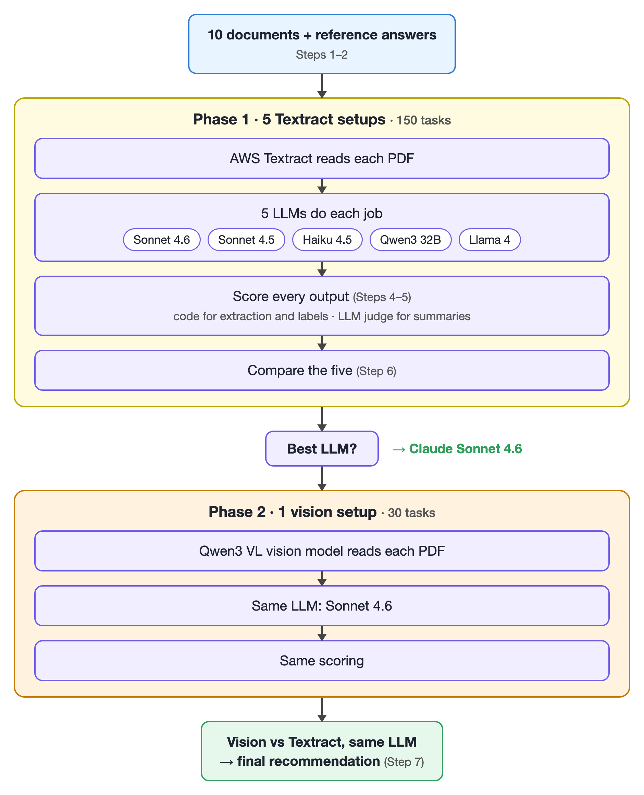

# AI Output Evaluation

How do you know whether an AI system's output is any good, and which model to choose? This
repository answers that with a complete, repeatable method. It walks through every step, from
hand-labelling the reference answers to the final recommendation, with the working code for each
step next to its explanation.

The worked example is **DocWeaver**, a document-processing app. DocWeaver reads a PDF with an OCR
engine (AWS Textract, or a vision model) and then asks an LLM to do one of three jobs:

| Job                | What DocWeaver returns                       | How we score it               |
| ------------------ | -------------------------------------------- | ----------------------------- |
| **Extraction**     | named fields, e.g. _Invoice Number_, _Total_ | deterministic text comparison |
| **Classification** | a document-type label for every page         | exact match, accuracy and F1  |
| **Summarization**  | a written summary                            | an LLM judge with a rubric    |

We compared **six model setups** on **10 hand-annotated documents** across the three jobs, which
came to **180 runs**, and **all 180 completed**. The answer: **use Claude Sonnet 4.6.** The full
results are in [07-results](07-results/README.md).

## How the six setups were run

The five Textract setups ran first. Only the best of them was then repeated with the vision
model, instead of running all five again.



**Why only one vision setup?** The vision model costs more to run, in both time and money. A
vision task took a median of 23.0 s against 7.2 s for the same LLM with Textract. Running all
five LLMs through it would have meant 150 more tasks; running only the winner took 30. Keeping
the LLM the same also makes the comparison clean: any difference comes from how the PDF was read.

## The method in eight steps

Step 0 decides _how_ to test; Steps 1–7 do it.

```text
 1. Ground truth        2. Screening          3. Running             4. Deterministic       5. LLM judge
 ───────────────        ───────────           ─────────              scoring                ───────────
 Annotate documents  ─► Check PDFs fit,    ─► Each document ×    ─► Extraction and     ─► Summaries vs
 in the annotation      try candidates        model setup × job      classification         reference, blind
 app; export JSON       before labelling      on DocWeaver           vs reference           rubric, 0–10
                                                                          │                     │
                                                                          └──────────┬──────────┘
                                                                                     ▼
                                                     7. Results  ◄──  6. Reporting
                                                     ──────────       ────────────
                                                     Recommendation,  Leaderboard, per-job tables,
                                                     evidence         outliers, Excel workbook
```

| Step                                                        | Read this to learn                                                               |
| ----------------------------------------------------------- | -------------------------------------------------------------------------------- |
| [00 · Testing strategy](00-testing-strategy/)               | why reference-based evaluation, the alternatives, how the tool is sanity-checked |
| [01 · Ground-truth annotation](01-ground-truth-annotation/) | the annotation app (with screenshots), what a reference answer is, the export    |
| [02 · Document screening](02-document-screening/)           | how documents are chosen and checked before they cost anyone labelling time      |
| [03 · Running pipelines](03-running-pipelines/)             | how every model setup is run safely, one task at a time, against a live API      |
| [04 · Deterministic scoring](04-deterministic-scoring/)     | how extraction and classification are scored without an LLM                      |
| [05 · LLM judge](05-llm-judge/)                             | how summaries are scored by a blind LLM judge with a fixed rubric                |
| [06 · Reporting](06-reporting/)                             | leaderboard, outlier rules, and how the stakeholder workbook is built            |
| [07 · Results](07-results/)                                 | the findings, the recommendation, and the evidence behind them                   |

Supporting documents:

- [docs/kss-session-guide.md](docs/kss-session-guide.md): a presenter's plan for a knowledge-sharing session (KSS) on this work
- [docs/lessons-learned.md](docs/lessons-learned.md): what we would tell the next team that evaluates AI output
- [docs/glossary.md](docs/glossary.md): the terms used throughout

## Repository layout

```text
00-testing-strategy/          why this approach fits, and how the evaluation code is sanity-checked
01-ground-truth-annotation/   the annotation app, ground-truth loader, the annotation export, the final reference
02-document-screening/        upload-limit checks, the screening command, difficulty analysis
03-running-pipelines/         DocWeaver API client, pipelines, task lifecycle, run matrix, guarded runner
04-deterministic-scoring/     text normalisation, confidence formula, extraction/classification scorers
05-llm-judge/                 rubric, judge request building, Gemini and Claude clients
06-reporting/                 aggregation, outlier rules, Markdown/HTML report, Excel workbook builder
07-results/                   final workbook, verified source workbook, the run records behind them
shared/                       config loading, the on-disk run store, a small concurrency pool
bin/                          command-line entry points
config/                       evaluation settings and the model setups ("variants")
docs/                         KSS guide, lessons learned, glossary
```

Each step folder holds its own code and a `README.md` that explains it. The steps import from
one another, so the whole thing still runs as one tool.

## Quick start

Requires Node.js 22.15 or later. Python 3 with `openpyxl` is needed only to rebuild the workbook.

```bash
npm install
npm run check                    # lint and format check; needs no keys or network
npm run preflight                # offline: config, ground truth, PDFs and the task count
npm run difficulty               # rank document categories and documents by verified score
npm run run:guarded              # offline: print the exact task plan the guarded runner would execute
npm run report:workbook          # rebuild 07-results/DocWeaver_Model_Evaluation.xlsx from the evidence
```

The annotation app is a separate Next.js app; see [Step 1](01-ground-truth-annotation/README.md#how-the-annotation-was-done) to run it.

Live runs need DocWeaver access and a judge key. Copy `.env.example` to `.env` and fill it in.

### The documents

The 10 evaluated PDFs are in [`data/`](data/), one sub-folder per category, so every command
above works straight after cloning. The full corpus (998 PDFs, 1.2 GB) is attached to the v1
release as `ai-output-eval-data-v1.tar.gz`; it is only needed to screen new candidates or to
browse other PDFs in the annotation app. To use it, extract it and point `dataDir` in
[config/eval.config.json](config/eval.config.json) (and `ANNOTATION_DATA_DIR` for the app) at the
extracted `data` folder. The documents are public records from DocumentCloud.

The end-to-end commands:

```bash
npm run run                      # run every document × model setup × job        → runs/<runId>/raw/
npm run score                    # score every output against the ground truth    → runs/<runId>/scores/
npm run report                   # leaderboard and outliers                        → runs/<runId>/report.{md,html,json}
```

Every command skips work that is already on disk, so after an interruption you rerun the same
command. The CLI is called `llmjudge`; run `node bin/llmjudge.mjs` with no arguments to see
its commands and options.
